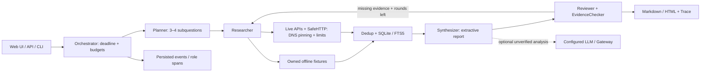
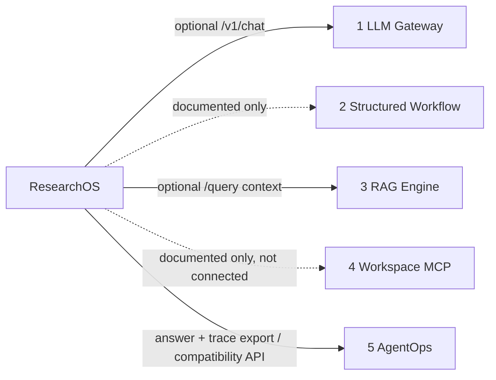

# ResearchOS · DeepResearch Agent

把开放调研任务做成可回查的执行过程：拆分子问题、检索资料、保存摘录、生成引用报告，
再用确定性检查和 Trace 解释结果与失败原因。默认免费离线，Python / CPU 即可运行。

**English overview.** An offline-first research workbench with bounded manager orchestration,
typed source records, SQLite/FTS memory, excerpt-bound citations, persisted traces, optional live
search and model adapters, and a local web UI. Fixture regression measures software behavior;
it does not establish open-domain research quality or semantic faithfulness.

[快速演示](docs/DEMO.md) · [架构](docs/ARCHITECTURE.md) · [集成](docs/INTEGRATION.md) ·
[验证记录](docs/VALIDATION.md) · [面试指南](docs/INTERVIEW_GUIDE.md)


## 解决什么问题

只有一篇流畅报告，无法知道来源是否存在、哪句话有证据、任务在哪里失败。
ResearchOS 保存 `request → plan → source → passage → claim → citation → report`，
使报告能够回到采集时间、来源地址和原始摘录；达到时间、调用次数或轮数上限时保留部分结果。

- **有限调度**：Orchestrator 显式调用 Researcher、Synthesizer、Reviewer；默认 3 个子问题，
  deep 模式 4 个，最多 2 轮补充检索，具备来源、时间、工具次数及模型费用预算。
- **来源与记忆**：Fixture、GitHub 官方 API、arXiv API、Brave Search + HTML Reader；
  URL / DOI / 摘录 hash 去重，SQLite + FTS5 保存证据和运行历史。
- **可回查引用**：默认逐条摘录式写作，校验引用存在、摘录绑定、编号、日期依据和参考文献内容。
  可选 LLM 只添加明确标注“未验证”的辅助分析。
- **可观察产品**：FastAPI 异步任务、SSE 事件、来源详情、报告预览/下载、Trace、取消和历史；
  原生 JavaScript 界面与后端同源交付，无 Node 构建前置。
- **可独立集成**：Gateway、RAG 和 AgentOps 适配器可选；缺少兄弟服务时使用本地实现。
  所有外部内容都没有工具执行权限。

## 快速开始

需要 Linux / WSL、Python 3.11+ 和已安装的 `uv`。命令均在本仓库根目录执行：

```bash
uv sync --extra dev --extra mcp --frozen
make demo
make serve
```

打开 <http://127.0.0.1:8000>。默认选择 **DEMO / OFFLINE**，不需要 `.env`、API Key、GPU
或模型下载。`make demo` 导出 `artifacts/demo/report.md`、`report.html`、`run.json`
和本地 SQLite；页面创建的任务保存在 `.runtime/`。这些运行数据默认不进 Git。

```bash
make lint
make test
make eval
curl --fail-with-body -sS http://127.0.0.1:8000/health
```

实际验证：`make test` **120 passed**，Ruff lint/format 通过；GitHub Actions 的 Python
3.11、3.12 各 **120 passed**，容器构建与健康检查通过。[本次 CI 日志](https://github.com/FouHe0720/deep-research-agent/actions/runs/39771277422)。

典型 CLI 输出（run_id 每次生成）：

```text
DEMO/OFFLINE run=<run_id> status=completed sources=6
Citation checks: True; artifacts: artifacts/demo
```

完整 API、SSE、取消、导出和联网演示见 [DEMO](docs/DEMO.md)；实际执行结果集中记录在
[VALIDATION](docs/VALIDATION.md)，不把协议 Mock 测试写成真实模型验证。

## 执行与证据流



每个引用必须绑定已存储 source 和 passage。检查通过表示结构完整，不能据此宣布来源
陈述真实、检索充分或语义蕴含成立。抓取时间与发布日期分开保存；显式年份过滤会排除
无发布日期的来源。GitHub 仓库搜索只读取官方 API 的公开描述，不声称阅读完整代码库。

## 可选真实检索与模型

复制 `.env.example` 后按需配置，勿提交实际 `.env`。`RESEARCH_ALLOW_LIVE=true` 才允许
Live 任务；默认 GitHub/arXiv 不要求付费 Key，Brave 需要操作者自己的 Search Key。
Web Reader 只读取允许访问的 HTML，不下载 PDF、不绕过付费墙或验证码。

OFFLINE 强制禁止外部 RAG/LLM 调用。LIVE 模式中的模型需显式配置 `RESEARCH_LLM_BASE_URL`、`RESEARCH_LLM_MODEL`、可选 Key、输入/输出
价格，并在任务中给出正 `max_cost_usd`。OpenAI-compatible 使用 `/chat/completions`；
项目 1 Gateway 使用 `/v1/chat`。没有模型配置时仍可完成摘录式报告；默认模型预算为 0。
usage 缺失保留 null，费用预检估算与服务报告的实际 tokens 分开。

| 兄弟项目 | 当前边界 |
| --- | --- |
| LLM Gateway | 可选 `GatewayClient`，适配 `/v1/chat` 和独立 OpenAI-compatible 协议 |
| Structured LLM Workflow | 已核对文档抽取接口；当前使用本地 Writer，未接入远程抽取 |
| RAG Knowledge Engine | 可选 `/query`，只取候选 chunks，标记检索上下文而非新网络来源 |
| Workspace Agent | 已审计其 stdio 文件工具；本项目 MCP 只读研究记录，未启动兄弟文件服务 |
| AgentOps Evaluation | 导出其 Research HTTP adapter 可校验的 answer + spans；不写入兄弟数据库 |



接口及实际本地跨仓库验证见 [INTEGRATION](docs/INTEGRATION.md)。

## 评测与已验证范围

默认离线题集包含至少 30 个分类主题，用于流程、引用完整性、预算和失败路径回归。
它们重复使用自编 **Agent Memory** 教学材料，不能据此推导各主题的研究准确率或覆盖率。
扩展到 100 题仍需人工审阅；程序生成主题不等于拥有可评分的事实 gold。

指标区分完成状态、来源有效性、引用链、子问题覆盖、延迟、工具成功及 token/cost 观测；
语义 Faithfulness 使用人工评审表，不制造自动正确率。实跑产物和验证分母见
[VALIDATION](docs/VALIDATION.md)。

已生成的[离线结果](eval/results/offline.json)：30/30 流程完成、30/30 引用结构检查通过、
90/90 Fixture 工具结果成功；人工审核题目为 0/30，真实 Source Validity、Faithfulness、
LLM tokens/cost 均为 null。可阅读[示例报告](eval/results/demo.md)、
[离线 HTML](eval/results/demo.html)和[兼容 Trace](eval/results/trace.json)。

实际联网已完成 GitHub + arXiv 混合案例：4 个来源（2 个项目、2 篇论文摘要），引用结构通过；
[真实采集报告](eval/results/live-mixed.md)与[Run](eval/results/live-mixed-run.json)含链接和采集时间。
这些是有限元数据/摘要调研，不代表完整网页、论文和代码阅读。Brave 与真实模型未实测。
模型协议使用 MockTransport 测试，并额外通过兄弟 Gateway/RAG 的实际本地 ASGI 契约
和 AgentOps validator 检查；没有执行真实模型调用。Docker/CI 状态以验证记录为准。

## 取舍与局限

这是单进程、本机优先的工程作品。默认同时 2 个任务、最多 20 个等待任务；单任务最多
20 个来源、300 秒、40 次工具请求和 2 轮。内存调度不能跨进程共享；SQLite 保留历史，
进程重启不能接续正在执行的网络调用。多用户生产部署需要独立身份、租户隔离、共享队列、
分布式配额及访问审计。

Planner 是确定性模板，角色是代码内显式契约；默认报告主要展示来源摘录，跨来源比较和
自主研究能力有限。`language` 选择中英文报告模板和模型指令；来源摘录保留原文，界面以中文为主。
语义 judge、更丰富的主题 gold、PDF/OCR、持久队列与多用户隔离是后续扩展方向。
公网 URL 的 DNS/重定向校验、IP 固定连接与 robots 策略详见 [SECURITY](docs/SECURITY.md)。

核心代码阅读顺序：`domain/models.py` → `services/engine.py` → `adapters/http.py` →
`services/evidence.py` → `api/app.py`，均位于 `src/researchos/`。
工程决策与简历表述见 [TECH_DECISIONS](docs/TECH_DECISIONS.md) 和
[RESUME_BULLETS](docs/RESUME_BULLETS.md)。代码与自编教学资料使用 [MIT License](LICENSE)。
