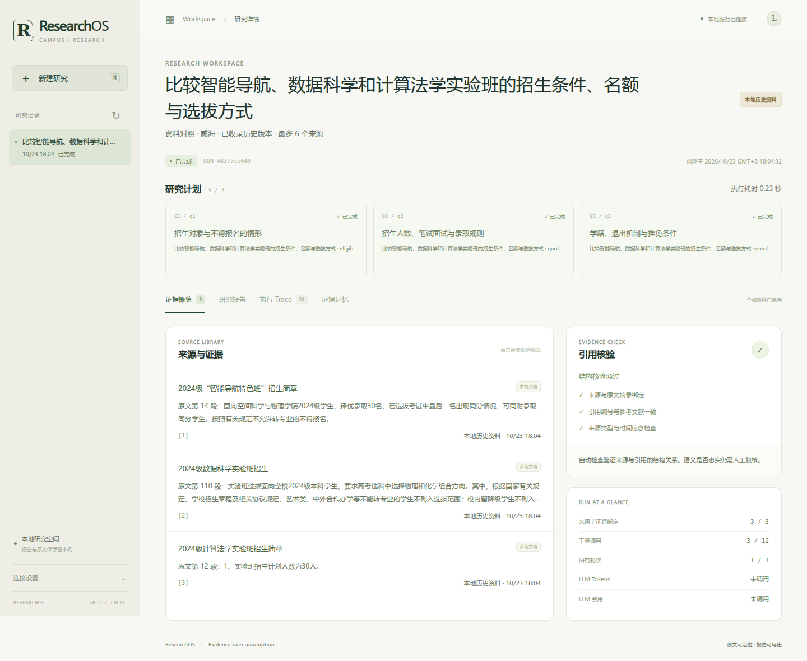

# ResearchOS · 资料研究工作台

把几份招生简章、培养方案放在一起比较，难点往往是条件不同：面向哪个校区、哪一届学生，名额是计划数还是固定上限，文档版号是否等于适用年级。

ResearchOS 用山东大学（威海）本地 RAG 知识库中的历史材料演示这个过程：限定资料范围，按问题收集原文，生成对照表，并保留每条引用的原文件、段落号和校验值。网页可以查看任务过程、原文和报告，也能下载 Markdown / HTML。



[校园案例与来源](docs/CAMPUS_CASE.md) · [运行说明](docs/DEMO.md) · [架构](docs/ARCHITECTURE.md) · [代码导览](docs/CODE_WALKTHROUGH.md) · [验证记录](docs/VALIDATION.md)

## 先看一个例子

“比较智能导航、数据科学和计算法学实验班的招生条件、名额与选拔方式。”

| 对照项 | 原文中的区别 |
| --- | --- |
| 招生范围 | 智能导航面向空间科学与物理学院2024级；数据科学面向全校2024级，另有选科及转专业限制 |
| 录取人数 | 数据科学按成绩取前25名；智能导航计划30名，但末位同分允许同时录取 |
| 推免条件 | 计算法学简章写明按班级人数30%计算；数据科学只说明具体名额以推免当年政策为准 |
| 培养要求 | 2024版计算机与人工智能方案都要求173学分，弹性修业年限分别是3至6年、4至6年 |

[查看招生报告](examples/campus-admissions.md)或[培养方案报告](examples/campus-curricula.md)。这些是本地真实材料的历史摘录，不能用于判断当前政策。案例报告采用原文抽取式对照，无需调用模型。

## 本地运行

需要 Python 3.11+ 和 `uv`，在仓库根目录执行：

```bash
uv sync --extra dev --extra mcp --frozen
make campus-demo
make serve
```

打开 <http://127.0.0.1:8000>。页面默认使用“山大威海 · 历史资料”，可以切换两个示例问题。`make campus-demo` 把报告、Run、Trace 和 SQLite 写到 `artifacts/campus/`。不需要模型、Key 或原始知识库。

```bash
# 比较专业培养要求；文档年度与适用年级分别筛选
.venv/bin/researchos '比较计算机科学与技术和人工智能专业培养方案的毕业学分与修业年限' \
  --corpus campus --document-year 2024 --output artifacts/curriculum

# Agent Memory 教学资料
make demo

make lint
make test
```

校园资料包有6份文档、55段原文，包含3份2024级招生简章、2份2024版培养方案和1份2023级培养方案。只写“2024版”的方案未被标成“2024级”；选了未收录的校区、年份或明确年级时，程序返回资料缺口。来源的发布时间缺失时保持为空。

## 实现


- **FastAPI + SSE**：异步队列、取消、历史记录和事件续读。默认同时执行2个任务，最多等待20个。
- **有限调度**：Planner、Researcher、Synthesizer、Reviewer 使用显式契约；限制时间、来源数、工具调用数、轮数和可选模型费用。
- **来源记录**：教学 Fixture、本地历史文档和网络采集分别标记。本地材料保存相对路径、原DOCX哈希、摘录哈希及原文段号。
- **引用检查**：核对 source → passage → claim → citation，校园对照表还会核对每个短摘录所属段落。改错名额或适用年级会被回归检查发现。
- **资料查询**：SQLite 保存来源和任务快照。英文词项用 FTS5；中文短语无FTS结果时按字面查询，保留任务隔离及通配符转义。
- **网页**：原生 JavaScript，无 Node 构建步骤；可查看来源详情、引用、执行事件和费用观测。

另支持 GitHub / arXiv / Brave 搜索、受限 HTML Reader，以及 Gateway / OpenAI-compatible、RAG 和 AgentOps 适配器。联网和模型需要显式配置，见[集成说明](docs/INTEGRATION.md)；校园资料模式不调用外部服务。

## 验证与边界

本地完整测试 **135 passed**，Ruff lint / format 和 JavaScript语法检查通过。校园测试覆盖名额与推免条件差异、版本与年级区分、资料缺失、原文及对照表篡改、API导出和中文查询。另用原始DOCX逐段核对了6份文件的哈希及55段摘录。命令和浏览器结果见[验证记录](docs/VALIDATION.md)。

校园检索是小资料包上的关键词路由，对照字段有人工选定的原文位置。子问题有来源绑定不代表语义研究充分；没有评估真实模型质量或开放领域准确率。30题教学回归单独运行，其结果不能用作校园问答准确率。

应用使用单进程本地队列，尚不支持多用户权限或分布式调度。校园报告目前使用中文模板；通用模式保留中英文报告。源码采用[MIT](LICENSE)，学校文档的权利归原作者，代码许可证不覆盖原文摘录。

**English:** A local research workbench built with FastAPI, SQLite and explicit bounded orchestration. The campus case compares attributed historical documents, preserves scope and paragraph provenance, and keeps deterministic extraction separate from optional model analysis.
