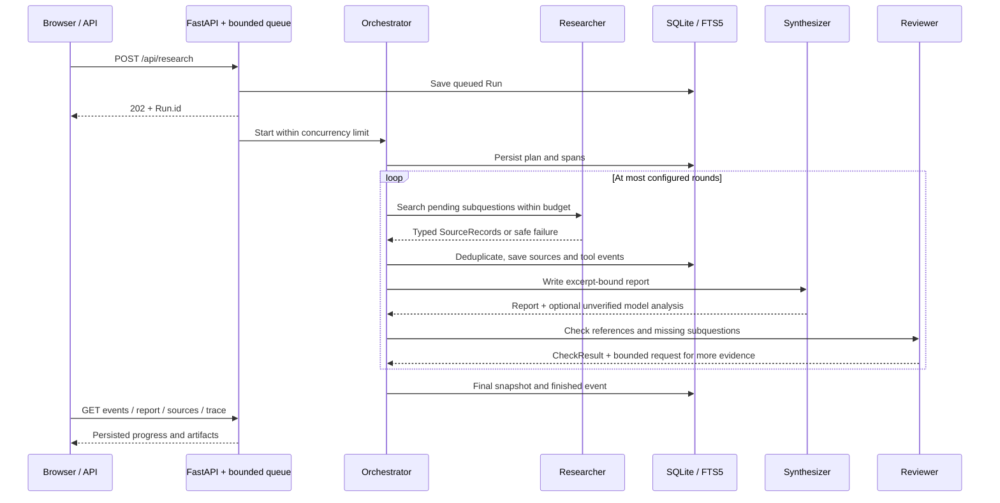
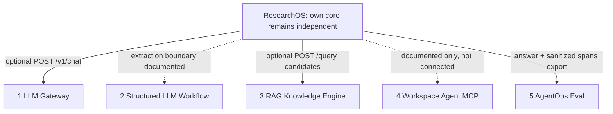

# 架构与执行边界

ResearchOS 采用同进程 Manager Pattern：Orchestrator 拥有执行状态和预算，显式调用角色，
外部资料和模型文本只作为数据进入系统。默认路径完全离线，兄弟服务均可缺席。

## 分层

| 层 | 关键文件 | 职责 |
| --- | --- | --- |
| Domain | `domain/models.py` | Request、预算、Plan、Source、Claim 和 Run 的公开契约 |
| Orchestration | `services/engine.py` | 总截止时间、有限轮次、部分结果、取消与最终状态 |
| Roles | `services/roles.py` | Researcher 返回来源，Synthesizer 写作，Reviewer 返回缺口 |
| Evidence | `services/memory.py`、`evidence.py`、`writer.py` | 去重、摘录绑定、引用结构校验与导出 |
| External | `adapters/fixture.py`、`live.py`、`http.py` | 来源获取、公网网络策略和失败边界 |
| Integrations | `adapters/integrations.py` | 模型/Gateway、RAG 检索和 AgentOps 兼容输出 |
| Persistence | `infra/store.py`、`trace.py` | SQLite 快照、来源、FTS5、事件及角色 spans |
| Product | `api/`、`static/`、`cli.py` | 异步任务、SSE、同源界面、命令行和报告下载 |

## 单次运行

Planner 为 standard/quick 生成 3 个方面，deep 增加评测复现方面，共 4 个。
Reviewer 只能请求补齐缺少证据的子问题；它不能绕过来源、请求次数、时间或轮数上限。
模型辅助分析至多调用一次，默认关闭。异常与预算耗尽保留已经采集的证据；失败信息只暴露
安全错误码或异常类别，不记录上游响应正文、密钥或带凭证的地址。

API 队列在单进程内维护，默认 2 个活动任务和 20 个等待位置。SQLite 是持久历史，不能
替代分布式执行队列；服务重启会中断内存中的调度，历史记录不会自动恢复外部请求。
不要启用多个 Uvicorn workers 来假装任务状态已共享。

## 证据与输出

`SourceRecord` 保存 URL/DOI、标题、作者、发布日期及依据、抓取时间、类别、摘录和
subtask IDs。URL canonicalization 去掉追踪参数，DOI 规范化，摘录 SHA-256 检测重复；
重复资料合并子问题关联，并写入去重事件。抓取时间不冒充发布日期。

`Claim` 保存 source_id、passage、citation_id、subtask_id。默认 Writer 使用来源摘录
生成报告，每个引用都可以回到已存储证据。EvidenceChecker 验证来源存在、摘录绑定、
子问题绑定、编号连续、正文/参考文献一致、日期依据及 Fixture/Network 区分。
它不重新访问全部链接，也不判断原文真假或复杂语义蕴含。

报告 HTML 禁用原始 HTML，并使用受约束 Markdown 渲染；辅助模型文本单独标记未验证，
不直接替换可信摘录 claims。模型输出即便生成了引用编号，也不能因此获得 SourceRecord。
本地 FTS5 与外部 RAG 的 hits 都属于检索上下文，外部 RAG 不自动成为新网络来源。

## 网络与权限

公网来源使用 SafeHTTP：限制协议、端口、地址和所有 DNS 结果，固定已验证 IP 连接，保留
逻辑 Host/SNI 与 TLS 校验。每跳重定向重新验证，跨源去掉认证头，不跟随 HTTPS 降级。
时间、字节、请求总数、域名并发和节流均有上限；网页读取每跳检查 robots.txt。

GitHub 只读取公开搜索元数据；arXiv 只读取 API 摘要；Web Reader 只处理允许访问的 HTML。
没有默认 PDF 下载、命令执行或任意 workspace 读取。配置的 LLM/RAG 地址由操作者信任，
允许本机服务，但不会接收网页提供的新服务地址。细节见 [SECURITY](SECURITY.md)。

## 兄弟项目的公共边界

实线表示本项目已有对应适配器/导出器，虚线表示能力边界不等于默认启用。
ResearchOS 自身的可选 MCP 只暴露 get_run、list_sources、search_memory，读取已经保存的
研究记录，不创建研究任务或发起外部请求。它与 Workspace 兄弟项目的文件 MCP 分开；
后者若接入必须绑定明确授权 workspace，不能成为调研正文扩大文件系统权限的入口。
项目 5 没有通用 HTTP trace import API，因此导出面向其现有远程 Research adapter 的
严格响应格式。实现和实际验证范围见 [INTEGRATION](INTEGRATION.md)。

## 评测的含义

默认固定教学资料使来源和引用结果可重复，适合测试故障、状态、预算和结构完整性。
不同题目复用 Agent Memory 资料，不能把程序覆盖率当作主题覆盖率。
语义 Faithfulness 需要人工标注或明确说明局限的辅助 judge。
真实联网测试、Mock 协议测试、本地跨服务 ASGI 检查与性能观测分别记录，见
[VALIDATION](VALIDATION.md)。
