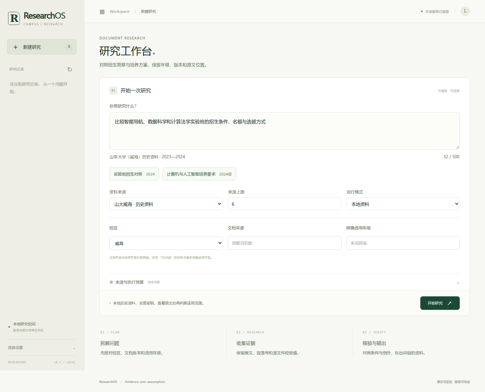

# 校园资料研究案例



这个案例处理两类问题：几份实验班简章的条件是否相同，以及几个专业培养方案的学分、学制有什么不同。材料取自本地 RAG 项目的山东大学（威海）知识库，使用历史材料复现研究过程，没有接入学校系统。

## 两个可运行问题

```bash
make campus-demo
.venv/bin/researchos '比较计算机科学与技术和人工智能专业培养方案的毕业学分与修业年限' \
  --corpus campus --document-year 2024 --output artifacts/curriculum
```

前一个问题输出[招生报告](../examples/campus-admissions.md)，后一个输出[培养方案报告](../examples/campus-curricula.md)。页面有对应示例按钮；查看来源可看到原文件相对路径、原DOCX哈希、原文段号和摘录。

对照字段不是模型生成的事实：`comparisons.json` 记录原文段号和一段原文短摘录，生成表格前核对短摘录确实出现在该段中。引用检查会重新构造对照表，防止表内名额、比例或范围与保存的摘录不一致。

## 收录资料

| 文档 | 版本年度 | 明确年级 | 关注的差异 |
| --- | --- | --- | --- |
| 智能导航特色班招生简章 | 2024 | 2024级 | 院内选拔；末位同分可以同时录取 |
| 数据科学实验班招生 | 2024 | 2024级 | 选科与转专业限制；录取前25名；没有明确推免百分比 |
| 计算法学实验班招生简章 | 2024 | 2024级 | 笔试60%、面试40%；推免计划按班级人数30%计算 |
| 计算机科学与技术专业培养方案 | 2024版 | 摘录未明确 | 173学分；弹性修业3至6年 |
| 人工智能专业培养方案 | 2024版 | 摘录未明确 | 173学分；弹性修业4至6年 |
| 物理学专业培养方案 | 2023 | 2023级 | 179学分；保留国际学分等原文要求 |

原文及清单在 [data/campus](../src/researchos/data/campus/manifest.json)。总计6份文档、55段；段号为 DOCX `word/document.xml` 中所有 `w:p` 的一基序号，包含空段与表格段。清单记录原DOCX字节哈希和打包Markdown摘录哈希，不保存原库的机器绝对路径。

没有导入教师联系方式、个人名单、账号或整库二进制。学校材料的版权归原作者，项目MIT许可证仅覆盖代码和项目自编内容。

## 范围与缺口

API使用独立字段：

```json
{
  "topic": "比较计算机与人工智能专业培养方案的毕业学分",
  "mode": "offline",
  "corpus": "campus",
  "campus": "威海",
  "document_year": 2024,
  "cohort": null
}
```

`document_year` 筛选资料版本年度，`cohort` 只匹配原文明确的年级。上例若设置 `cohort=2024`，两份培养方案会被排除，因为仅凭“2024版”不能确定适用年级。题目中的单一年度、明确的“某年级”和校区也会缩小范围；显式字段优先。

`time_range` 仍表示来源发表年份，不能替代文档年度。校园材料没有可靠发布时间，因此不会为了满足年份筛选而虚构日期。选2025年、青岛校区或未收录主题时，报告给出资料不足；不会改用教学Fixture填充。

检索采用已知专业与实验班的关键词，计划固定拆成三个业务方面。它适合复查这六份材料，不支持任意校园问题的语义检索。资料只包含节选，无法判断完整课程替代、最新招生政策或个人报名资格。校园报告当前为中文模板。

## 核对来源

```bash
# 不需要原库：校验打包摘录、清单段落及全部对照字段
make verify-campus

# 持有原库时：另外核对原DOCX哈希和原文段落
.venv/bin/python scripts/verify_campus_sources.py --knowledge-root "$CAMPUS_KNOWLEDGE_ROOT"
```

第二条命令只读取清单中的6份DOCX。程序正常演示不依赖这个变量或原始目录；原文核对属于单独的可选步骤。2026-10-23已用原库实际完成一次核对，6份文件哈希与55段原文均一致。

## 复查的技术问题

- 跨文档差异：数据科学推免条件不能被计算法学的30%覆盖；导航的30名不能丢掉同分条件。
- 版本和年级：2024版与2024级分别存储、筛选，未知年级不猜测。
- 摘录和表格：改动对照表中的25名为30名，或更改来源年级，引用检查应失败。
- 中文查询：FTS5未命中连续汉字中的短词时，按原文短语字面查询；参数化查询保留任务隔离，并转义通配符。
- 离线边界：回归中禁止HTTP调用，验证本地资料模式不访问搜索、RAG或模型端点。

对应测试在 [test_campus.py](../tests/test_campus.py)，实际执行结果见 [VALIDATION](VALIDATION.md)。
