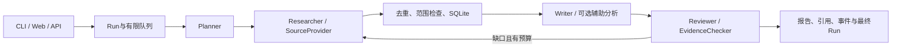

# ResearchOS 使用手册

本手册覆盖安装、命令行、网页、HTTP、只读MCP及可选服务配置，最后说明目录结构和执行机制。所有命令从本仓库根目录执行，示例适用于Linux、WSL或具有相同工具的终端。

校园资料是山东大学（威海）2023—2024年历史摘录；教学资料用于流程回归。联网来源与模型分析需要单独启用。正常使用本地资料不需要原始知识库、API Key、GPU或模型下载。

## 目录

- [1. 安装与启动](#1-安装与启动)
- [2. 三种资料路径](#2-三种资料路径)
- [3. 命令行完整用法](#3-命令行完整用法)
- [4. 网页每项功能](#4-网页每项功能)
- [5. HTTP接口一览](#5-http接口一览)
- [6. 用curl跑完创建、事件、导出与查询](#6-用curl跑完创建事件导出与查询)
- [7. 请求、范围与预算的准确含义](#7-请求范围与预算的准确含义)
- [8. Live来源、搜索与Reader](#8-live来源搜索与reader)
- [9. 全部服务环境变量](#9-全部服务环境变量)
- [10. 模型、Gateway与RAG的连接](#10-模型gateway与rag的连接)
- [11. AgentOps兼容入口与外部边界](#11-agentops兼容入口与外部边界)
- [12. 只读MCP：启动、工具与客户端](#12-只读mcp启动工具与客户端)
- [13. 测试、评测、浏览器与资料核对](#13-测试评测浏览器与资料核对)
- [14. Docker、Compose与数据持久化](#14-dockercompose与数据持久化)
- [15. 项目结构与关键文件](#15-项目结构与关键文件)
- [16. 端到端状态、算法与取舍](#16-端到端状态算法与取舍)
- [17. 常见问题与操作边界](#17-常见问题与操作边界)

## 1. 安装与启动

需要Python 3.11+和uv；安装Python依赖或Chromium需要网络或可用缓存。安装应用、测试及可选MCP依赖：

```bash
uv sync --extra dev --extra mcp --frozen
.venv/bin/researchos --help
make verify-campus
```

启动本地网页与API：

```bash
RESEARCH_DATA_DIR=.runtime/manual \
  .venv/bin/uvicorn researchos.api.app:app --host 127.0.0.1 --port 8106 --workers 1
```

打开 <http://127.0.0.1:8106>；健康检查为 <http://127.0.0.1:8106/health>。`make serve`、Dockerfile和仓库Compose默认使用8000端口；本手册使用8106，便于多个项目同时运行。端口由Uvicorn参数或容器映射决定，没有`RESEARCH_PORT`配置。

第一次可以不创建`.env`。需要保存配置时，复制`.env.example`为`.env`后按需修改；已有配置文件时直接编辑，避免覆盖。配置从当前工作目录的`.env`读取，进程环境变量优先。修改服务端配置后重启进程。

| 服务 | 本手册地址 | 用途 |
| --- | --- | --- |
| ResearchOS | `http://127.0.0.1:8106` | 网页、研究API、SSE |
| LLM Gateway | `http://127.0.0.1:8101` | 可选`/v1/chat`模型协议 |
| RAG Knowledge Engine | `http://127.0.0.1:8103` | 可选`/query`辅助检索 |
| AgentOps | `http://127.0.0.1:8105` | 外部评测平台；通过适配器调用ResearchOS |
| ResearchOS只读MCP | stdio | 由MCP客户端启动，不监听HTTP端口 |

这些外部服务不会随ResearchOS自动启动。Structured LLM Workflow和Workspace Agent目前没有接入执行流程；Workspace的文件MCP也不会被本项目启动。

## 2. 三种资料路径

| 请求设置 | 来源 | 是否访问外部服务 |
| --- | --- | --- |
| `mode=offline, corpus=campus` | 六份校园历史文档、55段摘录 | 否 |
| `mode=offline, corpus=teaching` | 自编Agent Memory教学Fixture | 否 |
| `mode=live, corpus=teaching` | GitHub、arXiv、Brave及HTML Reader | 是；模型和RAG另需配置 |

`corpus=teaching`在Live请求中保留为默认字段，来源实际由Live provider决定。`mode=live, corpus=campus`会被参数校验拒绝，不存在“校园资料加实时模型”的标准模式。

校园包包括智能导航、数据科学、计算法学招生资料，计算机与人工智能2024版培养方案，以及物理学2023级培养方案。学校原文权利归原作者，代码MIT许可证不覆盖这些摘录。

## 3. 命令行完整用法

直接运行教学案例，或显式选择校园案例：

```bash
.venv/bin/researchos --output artifacts/manual/teaching
.venv/bin/researchos --corpus campus --campus 威海 --document-year 2024 \
  --output artifacts/manual/admissions
.venv/bin/researchos '比较计算机科学与技术和人工智能专业培养方案的毕业学分与修业年限' \
  --corpus campus --document-year 2024 --output artifacts/manual/curriculum
.venv/bin/researchos '2023级物理学专业培养方案的毕业学分' \
  --corpus campus --cohort 2023 --output artifacts/manual/physics
```

| 参数 | 默认值 | 含义与约束 |
| --- | --- | --- |
| `topic`，可省略的位置参数 | 随资料包选择 | 教学默认Agent Memory问题；校园默认三个实验班对照；去除首尾空白后3—500字符 |
| `-h / --help` | — | 打印帮助 |
| `--output` | `artifacts/demo` | 输出目录；SQLite也放在此目录 |
| `--mode` | `offline` | `offline / live`；Live另需服务配置允许 |
| `--corpus` | `teaching` | `teaching / campus` |
| `--campus` | 未设置 | `威海 / 济南 / 青岛`；校园包仅收录威海 |
| `--document-year` | 未设置 | 1900—2100，校园文档年度 |
| `--cohort` | 未设置 | 1900—2100，只匹配原文明确的适用年级 |
| `--providers` | `github arxiv` | 空格分隔，1—3项，允许`github arxiv web` |
| `--max-sources` | `6` | 1—20个去重后的来源 |
| `--max-seconds` | `60` | 0.05—300秒，Engine内部执行预算 |
| `--max-cost-usd` | `0` | 0—5美元；0不调用可选模型 |
| `--language` | `zh` | `zh / en`；通用报告切换语言，校园模板仍为中文 |
| `--time-range` | 未设置 | `YYYY-YYYY`，1900—2100且起年不大于止年，按来源发表年份筛选 |

CLI没有`--depth`、`--max-tool-calls`或`--max-rounds`参数。这三项分别使用请求默认值`standard`、12、1；要调整请使用网页、HTTP请求或Python契约。

每次生成`report.md`、`report.html`、`run.json`、原始事件列表`trace.json`、兼容响应`agentops.json`及`research.db`。同一输出目录再次运行会覆盖这些导出文件，数据库中的不同Run仍分别保存。

输出状态`failed`时CLI退出码为1；`partial`仍会保留报告，当前退出码为0。参数或配置校验异常也会非零退出。自动化时应同时检查`run.json`中的`status`、`reasons`和`checks`。

## 4. 网页每项功能

1. 默认进入校园资料表单，两个示例按钮分别填入招生对照和培养方案问题。
2. “资料来源”切换校园与教学资料；“运行模式”切换本地与联网。联网未启用时不能选择。
3. 校园表单直接显示校区、文档年度、明确适用年级；不显示通用研究深度、发表年份与英文模板选项。
4. 教学或Live模式显示快速概览、标准研究、深入研究、来源上限、发表年份及报告语言。quick和standard当前采用相同的三个计划方面。
5. “来源与执行预算”展开后可选GitHub、arXiv、Web及时间、工具次数、轮次、费用额度；来源选择仅在Live中生效。
6. 提交后显示计划、子问题状态、执行耗时、来源列表、引用检查和调用观测。
7. 点击来源查看原文、采集时间、日期依据及关联子问题；校园来源还显示原DOCX路径、段落号、校区、年级和哈希。
8. “研究报告”预览Markdown渲染结果；点击引用打开相应来源。可下载Markdown与HTML。
9. 手机报告表格在自己的容器内横向滚动，不会撑宽整页。
10. “执行Trace”查看事件、角色、工具结果及耗时；展开行查看JSON。网页下载的是含`schema/config/usage/events`的包装对象。
11. “证据记忆”只查询当前Run的已存标题与摘录，最多返回5个来源，不进行新搜索。
12. 侧栏显示历史，刷新按钮重新读取；选中记录后URL中的`?run=...`支持刷新后继续查看。
13. 任务未结束时可“停止研究”；停止保留已有来源和记录。已完成任务不会被改成取消。
14. “新建研究”返回表单，不会删除历史。光标不在输入框且弹窗关闭时，按`N`也可新建。
15. 标签页支持左右方向键、Home和End。来源弹窗可用关闭按钮、Escape或点击外部区域关闭。

服务配置入站Key后，在侧栏“连接设置”填入相同Key。网页将其作为Bearer头发送，仅保存于当前浏览器会话的sessionStorage。它与模型供应商Key、GitHub Token和Brave Key是不同凭证。

## 5. HTTP接口一览

FastAPI另提供`/docs`、`/redoc`及`/openapi.json`。研究接口启用入站Key后需要认证；首页、静态文件、健康检查、配置标志与API说明不要求该Key，但仍受Host检查限制。

| 方法与路径 | 主要参数 / 返回 |
| --- | --- |
| `GET /` | 网页入口 |
| `GET /static/{path}` | 同源JavaScript、CSS等静态资源 |
| `GET /health` | `status/service/active/queued`，并检查数据库连接 |
| `GET /api/config` | `allow_live/auth_required`，不返回Key |
| `POST /api/research` | ResearchRequest；返回202及queued Run |
| `GET /api/research` | `limit=50`，1—100；返回历史摘要 |
| `GET /api/research/{id}` | 完整Run，包括请求、计划、来源、报告、检查、原因和usage |
| `POST /api/research/{id}/cancel` | 取消排队或执行中的任务，返回最终快照 |
| `GET /api/research/{id}/sources` | 来源数组 |
| `GET /api/research/{id}/memory` | 必填`q`，1—500字符；最多5条本地命中 |
| `GET /api/research/{id}/report` | `format=md|html`，默认md；未有报告返回409 |
| `GET /api/research/{id}/trace` | `format=json|agentops`，默认原始事件列表 |
| `GET /api/research/{id}/events` | SSE；`after`查询参数与`Last-Event-ID`请求头 |
| `POST /api/agentops/research` | 同步等待教学流程结束，返回`{answer,trace}` |

交互式API说明使用FastAPI默认的外部CDN资源；断网时页面可能不能完整加载，但同源的 `/openapi.json` 与研究网页仍可访问。

Run ID为32位小写十六进制。不存在或格式不符返回404。JSON契约禁止额外字段；请求体最多32768字节。

## 6. 用curl跑完创建、事件、导出与查询

保持第1节的服务运行，另开终端。以下默认本地未设置入站Key：

```bash
RESEARCH_URL=http://127.0.0.1:8106
RESEARCH_EXPORT=artifacts/manual/http
mkdir -p "$RESEARCH_EXPORT"
curl --fail-with-body -sS "$RESEARCH_URL/health"
curl --fail-with-body -sS "$RESEARCH_URL/api/config"
curl --fail-with-body -sS "$RESEARCH_URL/openapi.json" \
  -o "$RESEARCH_EXPORT/openapi.json"

curl --fail-with-body -sS "$RESEARCH_URL/api/research" \
  -H 'Content-Type: application/json' \
  --data '{"topic":"比较智能导航、数据科学和计算法学实验班的招生条件、名额与选拔方式","mode":"offline","corpus":"campus","campus":"威海","document_year":2024,"max_sources":6}' \
  -o "$RESEARCH_EXPORT/created.json"

RESEARCH_RUN_ID=$(.venv/bin/python -c \
  'import json,sys; print(json.load(open(sys.argv[1]))["id"])' \
  "$RESEARCH_EXPORT/created.json")
export RESEARCH_RUN_ID

curl --fail-with-body -sS -N \
  "$RESEARCH_URL/api/research/$RESEARCH_RUN_ID/events" \
  -o "$RESEARCH_EXPORT/events.sse"
curl --fail-with-body -sS \
  "$RESEARCH_URL/api/research/$RESEARCH_RUN_ID" \
  -o "$RESEARCH_EXPORT/run.json"
curl --fail-with-body -sS "$RESEARCH_URL/api/research?limit=10"
curl --fail-with-body -sS "$RESEARCH_URL/api/research/$RESEARCH_RUN_ID/sources"
curl --fail-with-body -sS --get \
  "$RESEARCH_URL/api/research/$RESEARCH_RUN_ID/memory" --data-urlencode 'q=统计学'

curl --fail-with-body -sS \
  "$RESEARCH_URL/api/research/$RESEARCH_RUN_ID/report?format=md" \
  -o "$RESEARCH_EXPORT/report.md"
curl --fail-with-body -sS \
  "$RESEARCH_URL/api/research/$RESEARCH_RUN_ID/report?format=html" \
  -o "$RESEARCH_EXPORT/report.html"
curl --fail-with-body -sS \
  "$RESEARCH_URL/api/research/$RESEARCH_RUN_ID/trace?format=json" \
  -o "$RESEARCH_EXPORT/events.json"
curl --fail-with-body -sS \
  "$RESEARCH_URL/api/research/$RESEARCH_RUN_ID/trace?format=agentops" \
  -o "$RESEARCH_EXPORT/agentops.json"
```

`202`只表示任务已接收。SSE会在任务结束并排空最终事件后关闭；此后检查Run的终态，而非仅依据HTTP成功。`sources`和`checks`可能在任务执行时逐步更新。

启用入站认证后，对每条研究接口curl增加`-H "Authorization: Bearer $RESEARCH_API_KEY"`；Key由操作者设置，不要写入示例JSON、报告或仓库。

### SSE续读

每条事件含`id: <seq>`和`data: <JSON>`，JSON中的`kind`区分事件类型；没有单独的`event:`行。空闲时约每5秒有注释心跳。序号是数据库全局递增值，不保证在某个Run中连续。

```bash
RESEARCH_LAST_EVENT=10
curl --fail-with-body -sS -N \
  "$RESEARCH_URL/api/research/$RESEARCH_RUN_ID/events?after=$RESEARCH_LAST_EVENT"
curl --fail-with-body -sS -N \
  -H "Last-Event-ID: $RESEARCH_LAST_EVENT" \
  "$RESEARCH_URL/api/research/$RESEARCH_RUN_ID/events"
```

两种游标同时给出时取较大者；只返回`seq > cursor`的事件。游标范围0—2^63−1，非法Last-Event-ID返回400。断开SSE不会自动取消任务，网页会尝试重新连接并使用游标恢复。

### 取消与错误

```bash
curl --fail-with-body -sS -X POST \
  "$RESEARCH_URL/api/research/$RESEARCH_RUN_ID/cancel"
```

本地任务很快，执行取消命令时可能已完成；此时返回原终态。排队中的任务可以直接取消，执行中的任务等待协作式清理后返回。并发、排队、取消和重启路径的确定性回归在`tests/test_jobs.py`。

| HTTP状态 | 常见原因 |
| --- | --- |
| 400 | Host不在允许列表，或SSE请求头游标非法 |
| 401 | 缺少或不匹配入站Bearer Key |
| 403 | Live未由服务端启用 |
| 404 | Run不存在或ID格式错误 |
| 409 | 报告尚未生成 |
| 413 | 请求体超过32768字节 |
| 422 | 字段不合法、校园与Live混用、Web缺Key、AgentOps不支持的选项 |
| 429 | 活动与等待任务总量达到上限；常规研究入口附`Retry-After: 5` |

错误统一放在`error.code/message`，参数错误另有`error.details`。网络或模型异常记录安全错误码，不回显上游正文或凭证。

## 7. 请求、范围与预算的准确含义

| ResearchRequest字段 | 默认值 | 约束 / 行为 |
| --- | --- | --- |
| `topic` | 必填 | 3—500字符，去首尾空白后仍须满足长度 |
| `mode / corpus` | `offline / teaching` | 网页默认选择campus；CLI和API默认teaching |
| `campus` | null | 校园模式校区过滤，允许威海、济南、青岛 |
| `document_year / cohort` | null | 1900—2100，两个独立条件 |
| `time_range` | null | 来源发表年份；无可靠日期的来源会被排除 |
| `max_sources` | 6 | 1—20；这是上限，不保证收集到该数目 |
| `depth` | standard | quick、standard均3方面，deep通用模式4方面；校园始终3方面 |
| `language` | zh | zh/en；校园报告当前使用中文模板 |
| `providers` | github、arxiv | 数组1—3项，Live中选择与轮换来源 |
| `budget.max_seconds` | 60 | 0.05—300，Engine超时段；不含排队等待和最终落库 |
| `budget.max_tool_calls` | 12 | 1—40；离线按检索调用，Live按实际公网HTTP请求计数 |
| `budget.max_rounds` | 1 | 1—2；只有缺证据且有预算时补查 |
| `budget.max_cost_usd` | 0 | 0—5，仅可选模型额度，不含Brave等供应商搜索费用 |

RAG与模型走独立适配器，不计入公网HTTP请求计数；它们仍受适配器自身及Engine时间预算约束。

完整预算请求示例：

```json
{
  "topic": "Agent Memory 的持久化与检索",
  "mode": "offline",
  "corpus": "teaching",
  "max_sources": 8,
  "depth": "deep",
  "language": "zh",
  "budget": {"max_seconds": 30, "max_tool_calls": 12, "max_rounds": 2, "max_cost_usd": 0}
}
```

校园范围按题目关键词与显式字段共同确定。题目中仅有一个年度时可用于文档年度，明确“2023级”可用于年级，单个校区名可用于校区；显式字段优先。多个年度、未识别专业或复杂比较不构成通用语义检索，必要时拆成清晰问题。

2024版计算机与人工智能培养方案未明确适用年级，因此`cohort=null`可以取得它们，`cohort=2024`会排除它们。2023级物理学方案明确年级，可按2023级筛选。没有匹配资料时返回空证据及原因，状态可为failed。

`document_year`不是`published_at`。教学和校园材料没有可靠发表日期；设置`time_range`会排除它们。不要把“文档年度2024”填进“发表年份2024—2024”来代替范围筛选。

## 8. Live来源、搜索与Reader

以下命令会访问公网，按需要自行执行；离线安装与演示不需要执行：

```bash
RESEARCH_ALLOW_LIVE=true .venv/bin/researchos 'agent memory' \
  --mode live --providers github arxiv --max-seconds 60 \
  --max-sources 6 --output artifacts/manual/live
```

网页服务同样需要`RESEARCH_ALLOW_LIVE=true`后重启。只设置请求`mode=live`不能绕过服务端开关。Live搜索失败不会退回本地Fixture。

- GitHub调用官方仓库搜索API，只保存公开仓库名称、描述、维护者与URL；不下载README或完整代码。Token可选，缺少发布日期时保持为空。
- arXiv调用Atom API，保存标题、作者、摘要、发布日期及DOI；不下载PDF。搜索词使用字面引用组合，最多取12个空格分隔项。
- Web使用Brave Search；在服务环境设置`RESEARCH_WEB_API_KEY`并选择`providers=["web"]`。API入口缺Key会在创建任务前返回422。
- HTML Reader读取Brave结果页面，先检查每跳robots.txt，再解析HTML，移除脚本、导航、表单等，优先取main/article正文，最多保留8000字符。
- robots缺失、无法取得、格式无效或禁止访问时拒绝读取。PDF、付费墙、验证码、网页脚本不在Reader功能内。
- Reader是provider内部能力，没有独立`/read`、任意URL抓取或文件上传HTTP端点。

Live查询使用规范化主题的前240字符；Planner的方面提示不会另行拼入官方API查询。每个子问题最多请求2个候选来源。provider优先顺序随子问题轮换，足够取得候选时不再调用后续provider；因此选择多个provider不保证每个都产生来源。单次运行缓存按provider、主题、候选数索引，TTL300秒、最多64项，跨子问题复用时更新关联。

实际HTTP预算包含robots、重定向和重试；source_search事件数与实际外发请求数可能不同。缓存命中不发新请求。限流、读取失败或来源不足会进入`reasons`，即使已有报告也可能为partial。

## 9. 全部服务环境变量

配置定义在`infra/config.py`；以下17项可由`.env`或进程环境设置。布尔值使用true/false，列表使用JSON数组。

| 变量 | 默认值 | 说明 |
| --- | --- | --- |
| `RESEARCH_DATA_DIR` | `.runtime` | HTTP与MCP数据库目录，实际文件`research.db` |
| `RESEARCH_MAX_JOBS` | 2 | 同时执行1—4个任务 |
| `RESEARCH_MAX_QUEUE` | 20 | 等待容量1—100；总接纳容量=活动上限+等待上限 |
| `RESEARCH_ALLOW_LIVE` | false | 是否允许公网研究 |
| `RESEARCH_ALLOWED_HOSTS` | localhost、127.0.0.1、::1、testserver | 精确hostname列表；不含端口，不使用通配符 |
| `RESEARCH_API_KEY` | 未设置 | 入站研究接口Bearer Key |
| `RESEARCH_WEB_API_KEY` | 未设置 | Brave Search Key |
| `RESEARCH_GITHUB_TOKEN` | 未设置 | GitHub API Token |
| `RESEARCH_LLM_BASE_URL` | 未设置 | OpenAI-compatible API根地址，通常含`/v1` |
| `RESEARCH_LLM_API_KEY` | 未设置 | 上述兼容模型服务的Key |
| `RESEARCH_LLM_MODEL` | 未设置 | 显式模型ID，没有默认模型 |
| `RESEARCH_LLM_KIND` | openai | `openai / gateway` |
| `RESEARCH_LLM_INPUT_USD_PER_MILLION` | 未设置 | 每百万输入token价格，须非负 |
| `RESEARCH_LLM_OUTPUT_USD_PER_MILLION` | 未设置 | 每百万输出token价格，须非负 |
| `RESEARCH_GATEWAY_URL` | 未设置 | gateway协议服务根地址或`/v1`地址 |
| `RESEARCH_GATEWAY_API_KEY` | 未设置 | gateway协议认证Key |
| `RESEARCH_RAG_URL` | 未设置 | 辅助RAG服务根地址，不包含`/query` |

`RESEARCH_ALLOWED_HOSTS='["localhost","127.0.0.1","research.example.test"]'`是格式示例。入站Host检查应用于全部路由；绑定`0.0.0.0`不会自动允许任意Host。

浏览器脚本另外读取`RESEARCH_BROWSER_EXECUTABLE`以选择已有Chromium，以及`RESEARCH_API_KEY`完成真实UI认证。没有ResearchOS级别的`RESEARCH_RAG_API_KEY`、`RESEARCH_AGENT_ENDPOINT`或模型超时环境配置；适配器类的可编程参数不等同于服务环境选项。

## 10. 模型、Gateway与RAG的连接

### 模型协议与启用条件

只有Live综合阶段会考虑外部模型：需要正`max_cost_usd`、明确模型ID、两个明确价格和相应服务地址。离线模式提前返回，连本机模型与RAG也不调用。模型分析最多一次，输出标注“待人工核验”，不替换已绑定原文。

| kind | 地址配置 | 请求与返回 |
| --- | --- | --- |
| openai | `RESEARCH_LLM_BASE_URL` | `POST {base}/chat/completions`，读取`choices[0].message.content` |
| gateway | `RESEARCH_GATEWAY_URL` | 根地址拼`/v1/chat`，或`/v1`后拼`/chat`；读取`answer` |

Gateway示例配置如下。先把模型ID与价格替换成所连接服务的实际配置，再启动ResearchOS；这些变量不会启动Gateway：

```bash
export RESEARCH_ALLOW_LIVE=true
export RESEARCH_LLM_KIND=gateway
export RESEARCH_GATEWAY_URL=http://127.0.0.1:8101
export RESEARCH_LLM_MODEL="$RESEARCH_MODEL_ID"
export RESEARCH_LLM_INPUT_USD_PER_MILLION="$RESEARCH_INPUT_PRICE"
export RESEARCH_LLM_OUTPUT_USD_PER_MILLION="$RESEARCH_OUTPUT_PRICE"
.venv/bin/uvicorn researchos.api.app:app --host 127.0.0.1 --port 8106 --workers 1
```

`RESEARCH_MODEL_ID / RESEARCH_INPUT_PRICE / RESEARCH_OUTPUT_PRICE`在此仅是操作者准备的shell变量，不是新增应用配置。需要Key时另设`RESEARCH_GATEWAY_API_KEY`。切换兼容服务时改`kind=openai`，使用`RESEARCH_LLM_BASE_URL`及`RESEARCH_LLM_API_KEY`。

然后在Live任务中明确设置费用额度，例如`--max-cost-usd 0.01`。即使Gateway使用本地Mock，标准Live流程仍会访问所选公网搜索；只检查协议可运行`tests/test_integrations.py`，不需要Live请求。

费用预检按UTF-8字节数、每条消息128及固定256的封装余量估算输入，再加最多400输出token。价格未知或预估超额会在HTTP发送前拒绝；显式免费服务可将两个价格设为0，但单次模型启用额度仍需为正。预检不等于第三方账单保证。

消息只接受system/user/assistant角色。适配器最多接受100条消息，兼容协议单条最多32000字符；gateway协议还限制单条16000字符、合计32000字符。标准综合路径将来源与上下文组成的用户消息裁到14000字符，RAG辅助上下文最多6000字符，因此模型分析可能只见到部分资料，原文报告仍按已存来源输出。

Gateway发送`max_tokens=400`；OpenAI-compatible发送`max_completion_tokens=400`，不兼容时报告错误，不改协议重发。模型请求超时默认20秒、响应上限1MiB、无自动重试。usage缺失时tokens与费用保持null；只有total_tokens时无法计算分项费用。

### RAG辅助上下文

```bash
export RESEARCH_RAG_URL=http://127.0.0.1:8103
```

重启并发起Live任务后，综合阶段发送`POST /query`，参数为`question`、`strategy=hybrid`、`top_k=3`、`rerank=noop`、`rewrite=false`。读取`candidates[].chunk`的原文、定位及score/rank，忽略上游生成的answer。检索失败记录`rag_fallback`，保留已有报告。

当前适配器不传RAG的 `sources` 范围字段，远程查询按RAG服务的默认资料范围执行；校园校区、年度和年级条件不会自动转发。

RAG结果用于可选模型的辅助上下文；不写入Run.sources，也不自动建立可信引用。即使没有模型配置，只要Live并配置RAG地址，当前实现仍会发出辅助检索请求。离线校园包与远程RAG数据库是两条独立路径。

RAGAdapter类默认15秒、1MiB响应上限，支持显式代码参数`api_key`；标准Engine配置只提供URL，没有RAG Key环境映射。受认证保护的RAG代理需要另行扩展配置。ResearchOS不调用文档写入/删除端点。

## 11. AgentOps兼容入口与外部边界

以下请求完全使用本地教学资料，不访问真实搜索或模型：

```bash
curl --fail-with-body -sS "$RESEARCH_URL/api/agentops/research" \
  -H 'Content-Type: application/json' \
  --data '{"task":"Agent Memory 的持久化与检索","category":"retrieval","fixtures":{},"seed":42,"config":{"planner":true,"tool_descriptions":"improved","tool_retries":0}}'
```

该入口返回200及`{answer,trace}`，内部仍通过同一队列执行，但HTTP请求等待终态。`task`为3—500字符，category只能retrieval，seed为0—2^31−1。仅支持空fixtures、`planner=true`、`tool_descriptions=improved`、`tool_retries=0|1`；最后一项映射为1或2轮补检。seed不改变固定流程。

AgentOps的`ResearchAgentAdapter`名为`research_http`；在AgentOps进程中将`RESEARCH_AGENT_ENDPOINT`设为`http://127.0.0.1:8106/api/agentops/research`，需要入站Key时另配其`RESEARCH_AGENT_API_KEY`。这两个变量属于外部评测项目，不由ResearchOS读取。

AgentOps服务可运行在8105。ResearchOS不主动向8105上传记录，外部平台由自身适配器消费响应。导出最多1000 spans，answer最多20000字符；截断会附说明，完整报告留在本地。它与本地原始事件JSON、外部平台自身RunRecord导出不是同一格式。

Structured LLM Workflow只有接口边界说明，当前未调用其`/v1/analyze`；Workspace文件MCP也未接入。可直接使用的集成只有模型协议、RAG候选上下文、AgentOps兼容入口与导出，以及下一节的自身只读MCP。

## 12. 只读MCP：启动、工具与客户端

先通过网页/API在`.runtime/manual/research.db`生成记录，或将数据目录指向某次CLI输出。MCP使用同一个Store，不会自动查找其它数据库。

```bash
RESEARCH_DATA_DIR=.runtime/manual .venv/bin/python -m researchos.mcp_server
```

这是stdio协议进程，应由MCP客户端启动并通过标准输入输出通信；直接在终端启动后等待输入是正常现象，不能用curl连接。客户端配置中的command、cwd和env应由操作者指定。

| 工具 | 参数 | 返回 / 边界 |
| --- | --- | --- |
| `get_run` | `run_id` | 状态、主题、mode、checks、最多20000字符报告与truncated标志 |
| `list_sources` | `run_id` | 已存来源数组，包括摘录与校园来源定位 |
| `search_memory` | `run_id, query` | query 1—500字符，最多5条已存来源 |

三项工具都要求32位小写十六进制Run ID。参数不能指定任意文件路径或URL；工具不创建研究、修改文件、调用模型或发起新外部请求。HTTP Bearer Key不控制stdio，权限由本机客户端启动进程和选定数据库决定。

可用仓库已安装的MCP SDK客户端读取第6节Run：

```bash
.venv/bin/python - <<'PY'
import asyncio, os
from pathlib import Path
from mcp import Client, StdioServerParameters
async def main():
    root = Path.cwd()
    parameters = StdioServerParameters(
        command=str(root / ".venv/bin/python"),
        args=["-m", "researchos.mcp_server"], cwd=str(root),
        env={**os.environ, "RESEARCH_DATA_DIR": str(root / ".runtime/manual")},
    )
    run_id = os.environ["RESEARCH_RUN_ID"]
    async with Client(parameters, read_timeout_seconds=10) as client:
        tools = await client.list_tools()
        print([tool.name for tool in tools.tools])
        for name, arguments in (
            ("get_run", {"run_id": run_id}),
            ("list_sources", {"run_id": run_id}),
            ("search_memory", {"run_id": run_id, "query": "统计学"}),
        ):
            result = await client.call_tool(name, arguments)
            print(name, "error:", result.is_error)
asyncio.run(main())
PY
```

读取CLI数据时，将env中的`RESEARCH_DATA_DIR`改为相应`--output`目录，该目录须直接包含`research.db`。本项目MCP与Workspace Agent的文件工具属于不同进程及工具集合。

## 13. 测试、评测、浏览器与资料核对

```bash
make lint test
node --check src/researchos/static/app.js
make verify-campus
.venv/bin/python scripts/verify_campus_sources.py --knowledge-root "$CAMPUS_KNOWLEDGE_ROOT"
```

最后一条需要操作者持有原库，并把变量设为“知识库”根目录。正常演示不需要原库；该命令额外核对六份DOCX字节哈希及55个原文段落，段号包含空段与表格段。

`make eval`会写`eval/results/`。要保留已有报告，用独立输出目录：

```bash
.venv/bin/python scripts/evaluate.py \
  --dataset eval/research_questions.jsonl \
  --output artifacts/manual/eval/offline.json \
  --artifacts-dir artifacts/manual/eval/sample
.venv/bin/python scripts/expand_eval.py --generate artifacts/manual/candidates.jsonl
.venv/bin/python scripts/expand_eval.py --validate artifacts/manual/candidates.jsonl
```

evaluate的三个参数如上，默认dataset为`eval/research_questions.jsonl`、output为`eval/results/offline.json`，artifacts-dir默认取output父目录。每题使用临时独立SQLite，显式禁用环境中的联网、模型、Gateway与RAG配置。

30题重复使用教学材料，度量流程完成、来源完整性、引用链、计划绑定、词项要点命中、工具成功及耗时。互联网来源有效性与语义faithfulness为null。只有3个Agent Memory问题有要点标注，不能把它们的得分当作30个主题准确率。

expand_eval从至少10个类别生成恰好100条未审阅候选；对这些候选执行validate会非零退出，表示人工审阅未完成。`--dataset`可指定基线或待更新文件。只有人实际审阅某条后才记录：

```bash
.venv/bin/python scripts/expand_eval.py --dataset artifacts/manual/candidates.jsonl \
  --mark-reviewed candidate-001 --reviewer human-review-label
```

`--generate / --validate / --mark-reviewed`三者互斥；`--mark-reviewed`需要`--reviewer`，不会自动判断审阅质量。单条记录也不会让其余99条通过严格校验。人工语义评分表为`eval/human_review_template.csv`。

浏览器检查需要可选依赖与服务进程：

```bash
uv sync --extra dev --extra mcp --extra browser --frozen
uv run playwright install chromium
.venv/bin/python scripts/browser_smoke.py http://127.0.0.1:8106 \
  --corpus campus --screenshot artifacts/manual/browser/campus.png
.venv/bin/python scripts/browser_smoke.py http://127.0.0.1:8106 \
  --corpus teaching --screenshot artifacts/manual/browser/teaching.png
```

脚本验证真实SSE、来源弹窗、iframe引用、MD/HTML下载、查询、历史重载、1440px桌面与390px手机及报告布局。默认截图路径为`docs/screenshots/researchos.png`，保留已有图片时务必显式指定新路径。已有Chromium可通过`RESEARCH_BROWSER_EXECUTABLE`选择。

`make privacy`扫描已跟踪与新增文件中的密钥、私钥、机器路径及不应纳入的运行文件；`git diff --check`检查差异中的空白问题。构建wheel使用`uv build --wheel --out-dir artifacts/manual/package`。

## 14. Docker、Compose与数据持久化

仓库Compose默认映射`127.0.0.1:8000:8000`，与`make serve`会冲突。单独运行默认配置：

```bash
docker compose up --build -d
curl --fail-with-body -sS http://127.0.0.1:8000/health
docker compose down
```

需要8106映射时可直接运行镜像：

```bash
docker build -t researchos:local .
docker volume create researchos-manual-data
docker run -d --name researchos-manual -p 127.0.0.1:8106:8000 \
  -v researchos-manual-data:/data \
  --read-only --tmpfs /tmp:rw,size=32m,noexec,nosuid \
  --cap-drop ALL --security-opt no-new-privileges:true researchos:local
curl --fail-with-body -sS http://127.0.0.1:8106/health
docker logs researchos-manual
docker stop researchos-manual
docker rm researchos-manual
```

镜像内监听8000，由UID/GID 10001运行；数据目录为`/data`，健康检查约每10秒执行。Compose额外配置自动重启策略。命名volume保留历史；`compose down`默认不删除volume，显式删除volume才会清除其中数据。

镜像用`requirements.lock`及哈希安装运行依赖，没有安装pytest、Playwright或MCP extra；这些检查应在相应开发环境运行。Docker中访问其它容器应使用其可达服务名或网络地址，容器内`127.0.0.1`指容器自身，不是宿主机8101/8103服务。

CLI数据库由`--output`决定；HTTP和MCP数据库由`RESEARCH_DATA_DIR`决定。备份时先停服务再复制数据库，避免遗漏WAL中尚未合并的数据。更改目录不会迁移旧记录，回到原目录即可读回原库。

优雅退出会取消未完成任务并保留记录；异常退出后的启动恢复会把queued/running标记failed并记录interrupted，不会续接先前的外部调用。当前没有HTTP删除任务、任意文件读写或数据库迁移接口。

## 15. 项目结构与关键文件

```text
.
├── pyproject.toml / uv.lock        Python包、可选依赖与解析锁
├── requirements.lock             Docker运行依赖及哈希
├── Makefile                      install/lint/test/demo/campus-demo/serve/eval/privacy
├── Dockerfile / compose.yaml     单进程容器、健康检查、持久卷
├── .env.example                  可选配置模板
├── .github/workflows/ci.yml       Python 3.11/3.12检查及Docker任务
├── src/researchos/
│   ├── cli.py                    argparse入口与文件导出
│   ├── mcp_server.py             三项只读stdio工具
│   ├── domain/models.py          请求、预算、计划、来源、主张与Run契约
│   ├── api/app.py                路由、认证、Host/请求体边界、SSE
│   ├── infra/
│   │   ├── config.py             Settings及17项RESEARCH配置
│   │   ├── store.py              SQLite、来源、FTS、历史与事件
│   │   ├── jobs.py               并发槽、等待队列、取消与恢复
│   │   └── trace.py              角色span、父子关系与单调时钟
│   ├── adapters/
│   │   ├── fixture.py            教学SourceProvider
│   │   ├── campus.py             关键词路由、范围过滤与摘录校验
│   │   ├── live.py               GitHub/arXiv/Brave、HTML Reader与缓存
│   │   ├── http.py               DNS固定连接、SSRF、重试与节流
│   │   └── integrations.py       模型、RAG及AgentOps响应契约
│   ├── services/
│   │   ├── engine.py             总调度、轮次、预算、最终状态
│   │   ├── planner.py            确定性计划
│   │   ├── roles.py              Researcher/Synthesizer/Reviewer契约
│   │   ├── memory.py             URL/DOI/hash去重与关联合并
│   │   ├── writer.py             摘录报告、引用与安全HTML
│   │   ├── campus_report.py      逐段绑定的校园对照表
│   │   ├── evidence.py           来源、主张、引用及对照表检查
│   │   └── evaluation.py         题集校验、实际回归与指标导出
│   ├── data/fixtures.json        自编教学资料
│   ├── data/campus/              六份摘录、manifest、comparisons
│   └── static/                  原生index.html、app.js、style.css
├── scripts/                     evaluate、expand_eval、verify、browser、check_public
├── tests/                       pytest回归
├── eval/                        JSONL题集、人工评分表及已有结果
├── examples/                    两份校园实跑报告
├── fixtures/                    教学资料范围说明
├── docs/                        使用、架构、集成、安全及验证文档
├── .runtime/                    默认HTTP/MCP数据，忽略入Git
└── artifacts/                   CLI/检查导出，忽略入Git
```

测试按边界组织：`test_campus`验证真实摘录与业务差异；`test_mvp`验证最小报告闭环；`test_limits_memory`验证预算和去重；`test_network`验证网络安全与provider；`test_jobs`验证并发取消恢复；`test_api`验证HTTP；`test_roles_trace`验证角色与事件；`test_integrations`验证外部协议；`test_eval`验证指标；`test_mcp`验证内存SDK及实际stdio子进程。

增加校园资料需要同时维护manifest、摘录、关键词ALIASES和comparisons中的字段段号，并完成源文件核对；不是把任意文件放进目录就会自动建索引。校园包与服务自身SQLite也不是同一份知识库。

## 16. 端到端状态、算法与取舍

### 状态与数据流



`queued → running → completed / partial / failed / cancelled`。有来源、检查通过且没有未完成原因时completed；有来源但仍有原因或检查问题时partial；没有来源时failed。cancelled优先保留取消状态。状态表示程序条件，不代表语义答案正确。

一次API提交先落库queued再创建asyncio任务，信号量限制执行槽；每个任务拥有独立Engine及provider。默认2个执行槽+20个等待位置，达到总容量返回429。SQLite保存历史，内存队列不跨进程共享，因此只能使用单worker。

### 计划与角色

Planner是模板，不调用模型。Researcher调用provider并返回类型化来源；Engine每次最多取2个候选、应用发表年过滤、去重并更新子问题状态。Reviewer根据子问题是否绑定来源决定是否请求补查，而非判断材料在语义上充分。

Synthesizer先用Writer生成抽取报告，再在Live且配置满足时附加模型分析。外部文本始终是数据，不获得工具执行权。通用模板提供定义、代表资料、局限等方面；校园模板针对招生条件或培养要求生成固定三个方面。

### 去重、FTS与中文查询

URL规范化去除片段与常见跟踪参数，统一主机名和默认端口；DOI去掉前缀并转小写；摘录strip后计算SHA-256。URL、DOI或内容哈希任一相同则合并关联子问题，记录deduplicated事件，保留首次来源。

Store保存Run JSON、来源JSON、FTS5 passages与事件表。查询抽取最多20个词项，用转义的字面词构造OR查询，按FTS rank排序；仅在FTS零命中且查询含中文时，才对整段查询做参数化LIKE查找，并转义反斜杠、百分号、下划线。所有查询限制同一run_id，最多5条。

这个兜底解决默认unicode61无法把连续汉字拆成中文词的问题；它不是向量检索、中文分词器或语义排序。部分FTS命中时不会再补充LIKE结果，复杂中文问句可能没有命中，宜使用原文短语。

### 引用与校园对照

SourceRecord保存来源身份、类型、日期依据和原文；Claim保存source_id、passage、citation_id与subtask_id。Checker核对来源存在、摘录绑定、子问题有效、主张进入正文、连续编号、文内引用与参考文献一致，以及网络/Fixture/本地来源边界。

校园对照额外校验打包摘录哈希、段落文本、原文件元数据，并重建期望表格。comparisons中的短摘录必须属于指定原文段落；无法确定的字段写“摘录未说明”。原DOCX哈希只有另行提供原库时才能重新读取核对。

这些检查能发现表格中把25名改成30名、把未知年级改成2024级等错误，不能证明当前政策或一般语义蕴含。HTML禁用原始HTML与危险链接；模型分析单独标记，不因生成编号而变成可信Claim。

### HTTP安全与观测

SafeHTTP仅允许HTTP(S)和80/443端口，拒绝凭证URL、本地、私网、链路本地等目标。解析所有A/AAAA结果并验证，连接固定到已检查IP，保留原Host与TLS SNI，逐跳检查重定向并防止HTTPS降级、跨源凭证泄漏；不读取环境代理。

默认单次get总超时15秒、响应1000000字节、最多4跳重定向、最多2次重试；robots上限128000字节。禁止压缩响应。429/503或传输错误受有限重试约束，超过5秒的Retry-After不会提前重试。arXiv并发1、间隔至少3秒，GitHub并发2、间隔6.1秒，其它主机并发2、默认间隔0.5秒；同事件循环内跨任务共享节流。

模型/RAG地址由操作者配置，可指向内网，采用不同于不可信公网URL的边界；默认关闭环境代理和自动重定向。Trace用单调时钟记录实际span耗时，数据库保存事件与状态；导出的LLM tokens/cost仅使用观测值，缺失保持null。

## 17. 常见问题与操作边界

| 现象 | 排查与处理 |
| --- | --- |
| 端口占用 | `make serve`用8000；改用明确的`--port 8106`，或停止冲突服务 |
| `uv / python`命令不可用 | 安装uv与支持的Python；仓库命令使用`.venv/bin/python`，无需依赖系统`python`别名 |
| SQLite缺FTS5 | 使用包含FTS5的Python/SQLite构建；否则初始化passages表会失败 |
| 页面历史为空 | 核对服务工作目录与`RESEARCH_DATA_DIR`；CLI数据通常在自己的`--output`目录 |
| 校园方案筛选不到 | 区分版号与明确年级；先清空cohort及time_range，查看所收录年度 |
| 只有1—3个校园来源 | 数据包按所选问题取文档，max_sources是上限；不会补造来源 |
| Live不可选 / 403 | 设置`RESEARCH_ALLOW_LIVE=true`并重启，确认`/api/config` |
| Web缺Key | 配置`RESEARCH_WEB_API_KEY`；错误文字中的BRAVE_SEARCH_API_KEY指该provider凭证 |
| GitHub / arXiv很慢或partial | 查看reasons、限流、时间及实际HTTP预算；缓存和节流都可能影响来源数 |
| robots_unavailable / robots_denied | Reader按拒绝策略停止，不绕过访问限制 |
| 有模型地址但没调用 | 检查mode、kind、对应URL、显式model、正额度与两个价格；查看llm_fallback |
| usage / cost为null | 服务未报告使用量，或缺输入输出分项；不能据此推断零token或零费用 |
| RAG有命中但不出现在来源 | 命中只是辅助上下文；检查rag_hits与模型辅助分析路径 |
| MCP“没有输出” | 它在等待stdio客户端；先生成同一数据库的Run并用客户端调用工具 |
| 重启后任务failed | 中断任务不会自动重跑；历史来源仍保存，需显式重新提交 |
| 浏览器中文方块或缺共享库 | 安装合适中文字体与Chromium系统依赖，再运行浏览器检查 |
| 多worker历史状态不一致 | 共享SQLite不能共享内存调度；使用1 worker，分布式队列需另行实现 |

当前不提供用户/租户隔离、完整PDF/OCR、任意文件上传、远程模型管理、持久执行队列、开放域语义质量保证或自动政策更新。读取已有记录的接口也没有独立删除操作。公开部署需要自行补齐身份、访问控制、队列与审计。

本手册离线操作已用独立临时目录核对校园/教学CLI及实际本机HTTP、SSE、游标续读、来源、报告、Trace、查询、取消、AgentOps与MCP；没有调用Live搜索或真实模型。已有验证记录见 [VALIDATION](VALIDATION.md)，算法细节另见 [ARCHITECTURE](ARCHITECTURE.md)、[CODE_WALKTHROUGH](CODE_WALKTHROUGH.md) 和 [SECURITY](SECURITY.md)。
